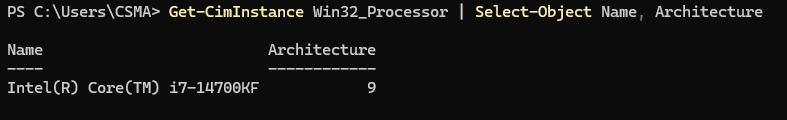
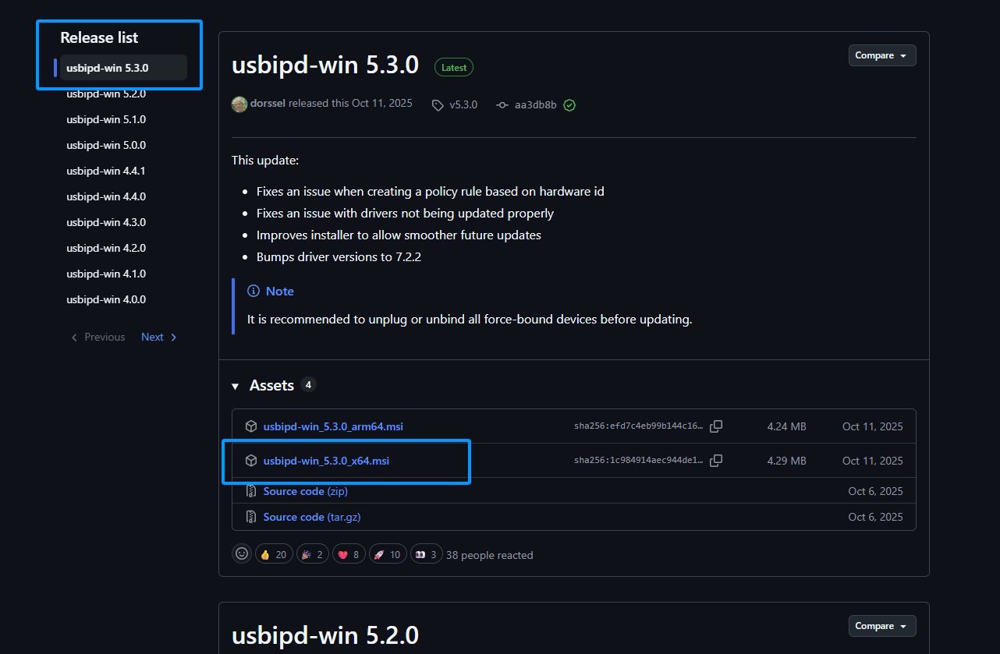
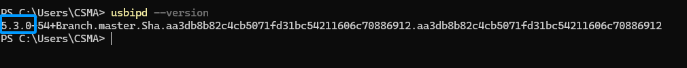
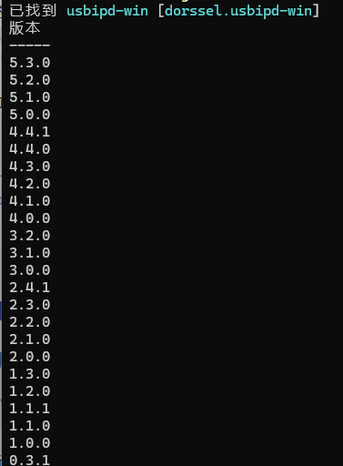
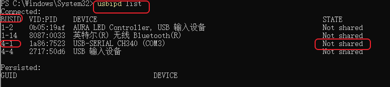
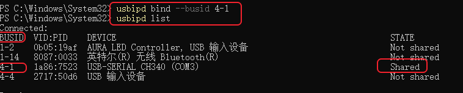
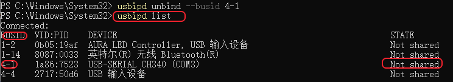
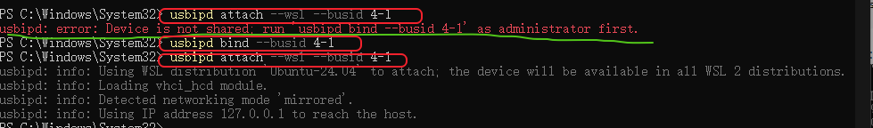
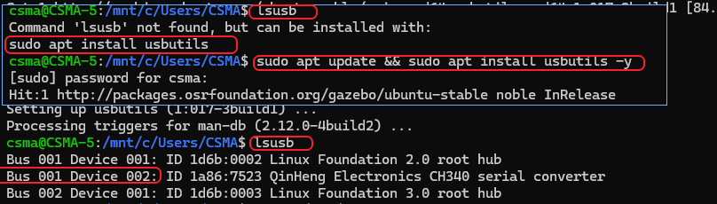

# WSL（Ubuntu）连接 Windows 的 USB 设备

> 目标：
>
> 通过开源项目 [usbipd-win](https://github.com/dorssel/usbipd-win/releases) 解决 `WSL2` 中无法连接 `Windows` 主机上的 `USB` 设备的问题。

---

# 一、在 WSL2 中使用 usbipd-win 的背景说明

`WSL`（`Windows Subsystem for Linux`，适用于 `Linux` 的 `Windows` 子系统）是微软提供的一项兼容技术，允许用户在 Windows 操作系统中运行 `Linux` 环境，而无需安装独立的 `Linux` 操作系统。其中，`WSL2` 基于 `Hyper-V` 虚拟化技术，通过轻量级虚拟机运行真实的 `Linux` 内核，为 `Linux` 应用程序提供较高的系统兼容性和运行效率。

与传统虚拟机相比，`WSL2` 无需用户手动创建和配置完整的虚拟机环境，并且支持动态资源分配，能够更加便捷地实现 `Windows` 与 `Linux` 环境的协同工作。我们可以在 `WSL2` 中安装 `Ubuntu`、`Debian` 等多个 `Linux` 发行版，还可以使用 `Linux` 命令行工具、开发环境及相关应用程序。毕竟，命令行才是软件工程师的浪漫哈哈。

然而，由于 `WSL2` 运行在独立的虚拟化环境中，其 `Linux` 内核与 `Windows` 主机之间存在一定的硬件访问隔离。虽然 `WSL2` 支持文件系统和网络等资源的交互，但默认不提供对 `Windows` 主机物理 `USB` 设备的直接访问能力。所以当我们沉浸在 wsl 中开发时，当我们需要在 `WSL2` 中使用 `USB` 串口设备、嵌入式开发板、硬件调试器等外部设备时，可能无法直接通过 `Linux` 工具识别和操作这些设备。

针对这一个问题，开源项目 [usbipd-win](https://github.com/dorssel/usbipd-win/releases) 诞生了：此项目提供了基于 `USB/IP（USB over IP）` 协议的 `USB` 设备共享与转发功能：[usbipd-win](https://github.com/dorssel/usbipd-win/releases) 运行在 `Windows` 主机端，通过 `USB/IP` 协议将连接到 `Windows` 的物理 `USB` 设备共享给 `WSL2`，使其能够在 `Linux` 环境中被识别，并通过相应的 `Linux` 驱动程序进行访问。

借助 `usbipd-win`，我们就可以在 `WSL2` 中使用部分原本连接在 `Windows` 主机上的 `USB` 设备，所以我们就可以开心的在 `wsl` 中进行嵌入式开发、固件烧录、串口通信及硬件调试等功能的尝试了。

> 注意：
>
> - 设备能否正常使用还取决于 `WSL2` 内核是否支持相应的驱动程序，因为此项目的本质是 `usb` 协议的共享与转发，设备正常工作的前提仍然是 `WSL2` 内核支持相应的驱动程序。
> - `USB` 设备连接到 `WSL2` 时，Windows 无法同时进行使用。

`usbipd-win` 为 `Windows` 与 `WSL2` 之间建立了 `USB` 设备共享通道，弥补了 `WSL2` 在物理 `USB` 设备访问方面的限制，为需要同时使用 `Windows` 和 `Linux` 开发工具的用户提供了更加灵活的开发环境。

---

# 二、准备工作（你需要做的事）

`usbipd-win` 不错，咋开始呢？好，开始你美好的 `usbipd-win` 时光需要这些实在是最基本的条件了：

- Windows 10 1809 及以上，或 Windows 11（推荐最新版）。
- 拥有管理员权限的用户账号（安装时需要管理员身份运行 PowerShell）。
- 稳定的网络（安装过程中需要下载文件）。
- x64 或 ARM64 处理器的机器（usbipd-win 目前不支持 x86）。
- WSL 已安装并设置为最新版本（可以查看 [想要真 Linux——WSL2 加 VS Code 环境搭建](https://awesome-embedded-learning-studio.github.io/Tutorial_AwesomeModernCPP/getting-started/07-wsl2-environment) 完成这个任务）。
- 已安装 Linux 发行版并设置为 WSL 2（一般默认为 wsl2）。

如果你不确定你的版本是否为最新版本，可以先关闭 wsl：

```powershell
wsl --shutdown
```

然后在 `powershell` 中直接执行 `wsl` 的升级命令：

```powershell
wsl --update
```

如果你的是最新版会显示以下页面：


> 如果不是它会自动进行升级，等待升级好就可以了。

---

# 三、软件下载与更新

> 注意：当你需要更新软件时，建议在更新前先 unbind 已共享的设备（或直接把设备拔掉），以免发生不必要的问题。

## 3.1 方式一：通过 GitHub 的方式

### 3.1.1 安装

1. 首先进入 [Releases-dorssel /usbipd-win](https://github.com/dorssel/usbipd-win/releases) 这个项目的最新发布页。
2. 判断你的电脑架构能不能下载或者是适合下载哪一个架构的安装包。判断自己电脑的所属架构：

   ```powershell
   Get-CimInstance Win32_Processor | Select-Object Name, Architecture
   ```

   

   这里的 `Architecture` 用来当作判断依据，判断的方法如下：

   | 数值 | 架构                   |
   | ---- | ---------------------- |
   | 0    | x86（32 位）           |
   | 5    | ARM（32 位）           |
   | 9    | x64（64 位 Intel/AMD） |
   | 12   | ARM64（64 位 ARM）     |

3. 然后选择你想要的版本和适配的安装包进行下载后运行 `msi` 文件后进行安装软件。现在以笔者此时的最新版本 `usbipd-win 5.3.0` 和 `Architecture` 为 `9` 对应的 `x64` 架构为例进行下载：

   

### 3.1.2 更新

首先做的就是查看你自己的 `usbipd` 的版本，以笔者为例：

```powershell
usbipd --version
```



然后可以去 [Releases-dorssel /usbipd-win](https://github.com/dorssel/usbipd-win/releases) 这个项目的最新发布页去进行版本的对比。比对下来真有新版本，就照安装那一步下载对应架构的新 `msi` 覆盖安装，安装程序会把旧版本替换掉。

---

## 3.2 方式二：使用 Windows 程序包管理器（winget）的方式

### 3.2.1 安装

#### 直接安装为最新版的版本

```powershell
winget install --interactive --exact dorssel.usbipd-win
```

这将安装：

- 一项名为（显示名称：USBIP 设备主机）的服务 `usbipd`。您可以使用 Windows 的“服务”应用来检查此服务的状态。
- 一个命令行工具 `usbipd`。该工具的路径将被添加到 PATH 环境变量中。
- 防火墙规则 `usbipd` 允许所有本地子网连接到该服务。您可以修改此防火墙规则以微调访问控制。

> 注意：如果省略 `--interactive` 参数，winget 可能会在安装驱动程序需要时立即重启您的计算机。

#### 安装为自己指定的版本

首先在 `powershell` 搜索对于 `usbipd` 有哪些版本可以安装：

```powershell
winget show --id dorssel.usbipd-win --exact --versions
```

然后在安装命令后补充你需要的版本就可以了：

```powershell
winget install --interactive --exact --id dorssel.usbipd-win --version <版本号>
```

以笔者此时的状态为例：



例如我需要安装 `usbipd-win 5.2.0` 版本：

```powershell
winget install --interactive --exact --id dorssel.usbipd-win --version 5.2.0
```

---

### 3.2.2 更新

#### 直接更新为最新版的版本

首先做的就是可以通过 `winget` 的方式查看你自己的 `usbipd` 的版本以及是否有可以进行更新的版本，以笔者为例：

```powershell
winget list --id dorssel.usbipd-win
```

如果存在可以升级的版本，可能的显示（与你的当前状态有关），以笔者为参考：

```text
Name        Id                  Version  Available  Source
usbipd-win  dorssel.usbipd-win  5.2.0    5.3.0      winget
```

此时可以直接进行版本的升级：

```powershell
winget upgrade --id dorssel.usbipd-win -e --interactive
```

当你更新完成后，可以执行：

```powershell
usbipd --version
```

确认版本是否如你所料进行了更新。想再确认一下源里还有没有新版本，重新跑一遍升级命令就行：

```powershell
winget upgrade --id dorssel.usbipd-win -e --interactive
```

如果确实没有可升级的版本，此时的显示是：


#### 更新为自己指定的版本

与安装类似，先在 `powershell` 搜索对于 `usbipd` 有哪些版本可以安装：

```powershell
winget show --id dorssel.usbipd-win --exact --versions
```

然后在更新命令后补充你需要的版本就可以了：

```powershell
winget upgrade --id dorssel.usbipd-win -e --interactive --version <版本号>
```

以笔者此时的状态为例：


例如我需要更新为 `usbipd-win 5.3.0` 版本：

```powershell
winget upgrade --id dorssel.usbipd-win -e --interactive --version 5.3.0
```

---

# 四、连接 USB 设备

> 注意：在附加 USB 设备之前，请确保你的电脑 WSL 命令行处于打开状态，这会使 WSL 2 轻型 VM 保持运行。同时由于 `usbipd bind --busid <busid>` 和 `usbipd unbind --busid <busid>` 这两个**是否将 `USB` 设备设置为共享的操作**需要 `powershell` 的管理员权限，所以接下来的操作为了方便我们连续执行，不必要连续切换，所以我们操作均在 `PowerShell` 的管理员模式下运行。

注意：如果不是以管理员模式运行这两个操作时会出现提示 `usbipd: error: Access denied; this operation requires administrator privileges.`

另外，`usbipd attach` 本身不需要管理员权限（`bind`/`unbind` 才要）：新版 usbipd-win 的 README 写得很明确，attach 用普通 PowerShell 就能跑，所以当将设备改为`Shared`状态然后没必要为了它一直开着管理员窗口，可以在普通的`powershell`快速的进行.

## 4.1 列出并共享设备

以管理员的这个有地位的身份（有地位就是好哈哈）打开 `powershell`，运行 `usbipd list` 列出所有的 `usb` 设备：

> 注意保持 `wsl` 处于运行状态，不要忘记。

```powershell
usbipd list
```

以笔者为例：



在附加 USB 设备之前，必须使用命令 `usbipd bind --busid <busid>` 先共享设备（必须做），从而允许它附加到 WSL2。共享是持久的：bind 一次之后重启电脑也还是 `Shared`，不用每次重来；`attach` 则相反，重启、重插、设备复位之后都得重新 attach（官方 README 的原话是 non-persistent）。运行 bind 后，再次使用命令 `usbipd list` 验证设备是否已共享。（后面的设备状态变成 `Shared`）

```powershell
usbipd bind --busid <busid>
```



当运行 `usbipd unbind` 时会取消 `usb` 设备的共享状态：

```powershell
usbipd unbind --busid <busid>
```

```powershell
usbipd list
```



当然，我们需要通过 `usbipd` 将 `windows` 与 `wsl` 建立联系，应该保持 `Shared` 状态——刚才的 unbind 只是演示，接着往下做的话，记得再执行一次 `usbipd bind --busid <busid>` 把状态改回来。

## 4.2 将 USB 设备附加到 WSL

设备处在 `Shared` 状态，接下来就可以把它接进 WSL2 了。执行之前先看一个最容易撞上的报错：

> 如果忘记将选中的 `usb` 设备状态改为 `Shared` 状态，会出现 `usbipd: error: Device is not shared; run 'usbipd bind --busid 4-1' as administrator first.` 的提示，此时只需将设备改为 `Shared` 状态然后重新附加到 WSL 即可。

```powershell
usbipd attach --wsl --busid <busid>
```

以笔者为例：



## 4.3 在 WSL 里确认设备

此时需要在 `wsl` 中检查 USB 设备是否已经成功挂载到 WSL2 上，在 `wsl` 中执行：

```bash
lsusb
```

> 第一次执行时需要先安装 `usbutils`：
>
> ```bash
> sudo apt update && sudo apt install usbutils -y
> ```

以笔者为例：



此时看到 `Bus 001 Device 002: ID 1a86:7523 QinHeng Electronics CH340 serial converter` 说明 `wsl` 已经识别到我接在 `Windows` 上的 `CH340 USB` 转串口设备。

> 由于笔者连接的是串口设备所以还需要检查一下在 `wsl` 下是否创建串口设备节点。

以笔者为例，在 `wsl` 下执行：

```bash
ls -l /dev/ttyUSB*
```


当看到 `/dev/ttyUSB0` 时说明串口设备节点已经创建成功。

如果你执行的时候显示：当前用户没有权限访问串口，可以执行：

```bash
sudo usermod -aG dialout $USER
```

这条命令的作用是：将当前 Ubuntu 用户添加到 `dialout` 用户组，让你可以不使用 `sudo` 就访问串口设备。

然后退出并重新进入 WSL，使用户组权限生效，此时再次执行 `ls -l /dev/ttyUSB*` 即可。

## 4.4 用完之后记得 detach

此时将 Windows 下的 USB 设备共享给 WSL 的任务就完成了，等等？真的完成了吗？笔者原来也是这样认为的，直到某一天晚上，丢，踩雷了：做实验时不小心将我的鼠标和键盘都绑定到 `wsl` 上了，当执行完 `usbipd attach` 后，笔者的鼠标和键盘都失灵了，叫“天天不应，叫地地不灵”，只能对着显示屏发呆，哈哈，此时就是通过将设备重新在端口物理性插拔解决的（注：我是文明的人不粗暴），虽然解决了，但是引出来了一个重要的问题：

> 在 `WSL` 中完成设备使用后，记得在 `PowerShell（Windows）` 里用 `usbipd detach --busid <busid>` 断开 USB 设备，才能在 Windows 里使用这个 USB 设备（这个是微软推荐的做法）。或者粗暴点，直接物理性把设备拔了，重新插一下，效果也一样。但是不知道有没有啥负面影响（目前还没发现，笔者当时是这样解决的，因为键盘失灵了，没招了...）。

---

# 附录 A 参考链接

## A.1 官方文档与项目页面

| 主题 | 链接 |
| ---- | ---- |
| WSL 连接 USB 设备 | [连接 USB 设备（Microsoft Learn）](https://learn.microsoft.com/en-us/windows/wsl/connect-usb) |
| usbipd-win 发布页 | [dorssel/usbipd-win Releases](https://github.com/dorssel/usbipd-win/releases) |
| WSL 下补 USB 驱动 | [usbipd-win Wiki：WSL support](https://github.com/dorssel/usbipd-win/wiki/WSL-support) |

## A.2 第三方补充资料

| 主题 | 链接 |
| ---- | ---- |
| Windows 的 USB 设备共享给 WSL | [将 Windows 下的 USB 设备共享给 WSL（ubuntu）（CSDN）](https://blog.csdn.net/zeandon/article/details/145424798) |
